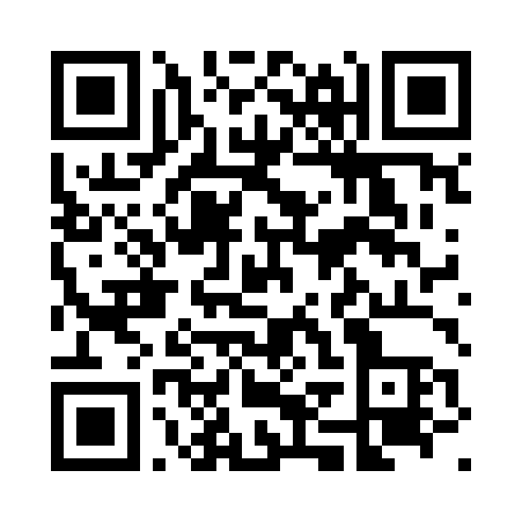

# ศรีจันทร์ ขอนแก่น — ร่วมเติมแลนด์มาร์ก 3 เขต

## ภาพสถานที่ 17 จุด — สีส้มและน้ำเงินคราม

[ดูภาพและดาวน์โหลดแยกรายสถานที่](https://loveiscomingsoon.github.io/srichan-landmarks/images/landmarks/) · [ไฟล์ภาพ](images/landmarks/) · [ข้อมูลหมุดพร้อมรูป](srichan-creative-map-17-with-artwork.geojson)

ภาพดัดแปลงด้วย AI จากภาพหมายเลข 1–17 ในแผนที่ศรีจันทร์ CREATIVE MAP ที่ผู้ใช้ให้ ใช้สื่อสารย่าน ไม่ใช่ภาพถ่ายบันทึกสภาพปัจจุบัน รายละเอียดอาคารและป้ายอาจคลาดเคลื่อน ชื่อไฟล์ 01.jpg–17.jpg ตรงกับหมายเลขภาพต้นฉบับและหมุดในชั้น Creative Map ข้อมูลตำแหน่งและสถานะรอตรวจภาคสนามยังคงเดิม

[เปิดแผนที่และร่วมเพิ่มจุด](https://umap.openstreetmap.fr/en/map/3_1471827)

## วิธีเพิ่มจุด

1. สแกน QR code หรือกดลิงก์แผนที่
2. กดปุ่มแก้ไขแผนที่ (รูปดินสอ) หากยังไม่อยู่ในโหมดแก้ไข
3. เลือก Draw a marker แล้วคลิกตำแหน่งภายในเขต 1–3
4. ใส่ชื่อแลนด์มาร์ก รายละเอียด และแนวคิดกิจกรรม ระบุว่าเป็นจุดเดิมหรือข้อเสนอใหม่
5. กด Save เพื่อบันทึกลงแผนที่ออนไลน์ร่วมกัน

แผนที่เปิดให้ทุกคนร่วมแก้ไขได้ ซึ่งรวมถึงแก้ไขหรือลบจุดเดิม โปรดตรวจสอบข้อมูลก่อนใช้จัดกิจกรรม ขอบเขตสามเขตเป็นแนวประมาณจากภาพ ไม่ใช่แนวรังวัดหรือการยืนยันสิทธิใช้งานพื้นที่

## ไฟล์และการเก็บข้อมูล

- `srichan-qr.png` / `srichan-qr.svg`: QR code เปิดลิงก์แผนที่โดยตรง
- `srichan-survey.geojson`: ขอบเขตและหมุดจากข้อมูลสำรองล่าสุด
- `umap-backup.umap`: สำรองแผนที่และการตั้งค่า ใช้กู้คืนใน uMap ได้
- `index.html`: หน้าเชื่อมแผนที่และ QR code
- `backup_umap.py`: ดาวน์โหลดข้อมูลสาธารณะโดยไม่ใช้รหัสหรือลิงก์แก้ไขส่วนตัว

GitHub Actions สำรองข้อมูลทุก 6 ชั่วโมงและเมื่อเรียก Run workflow โดยเขียน commit เฉพาะเมื่อข้อมูลเปลี่ยน หมุดที่เพิ่มจะบันทึกใน uMap ทันทีเมื่อผู้เพิ่มกด Save แล้วตามมาสำรองใน GitHub รอบถัดไป การสำรองไม่ใช่การซิงก์แบบทันที และยังขึ้นกับการเปิดใช้งาน GitHub Actions และบริการ uMap

หากตารางงานถูกพักจากการไม่มีความเคลื่อนไหวใน repository ให้เปิด workflow อีกครั้งในแท็บ Actions

[ดูแผนที่ออนไลน์](https://umap.openstreetmap.fr/en/map/3_1471827) · [ไฟล์ QR สำหรับพิมพ์](srichan-qr.svg)
